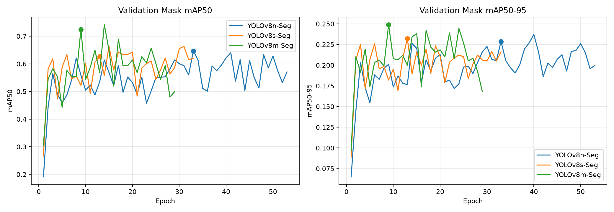
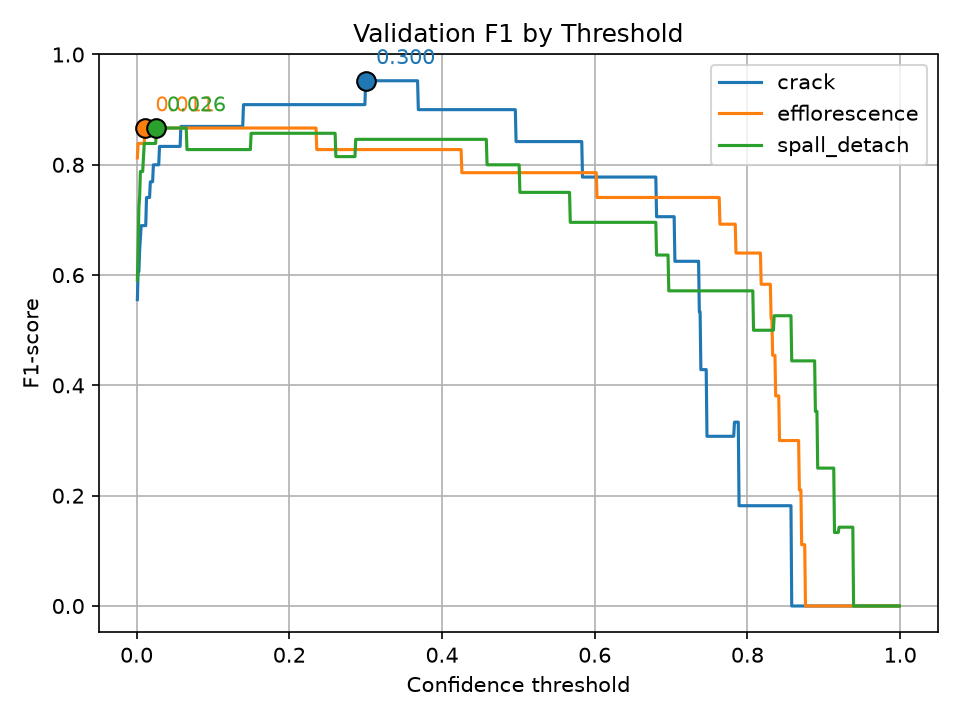
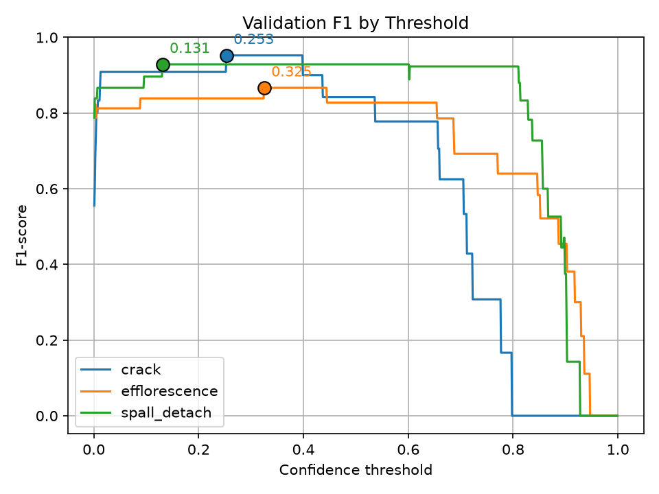
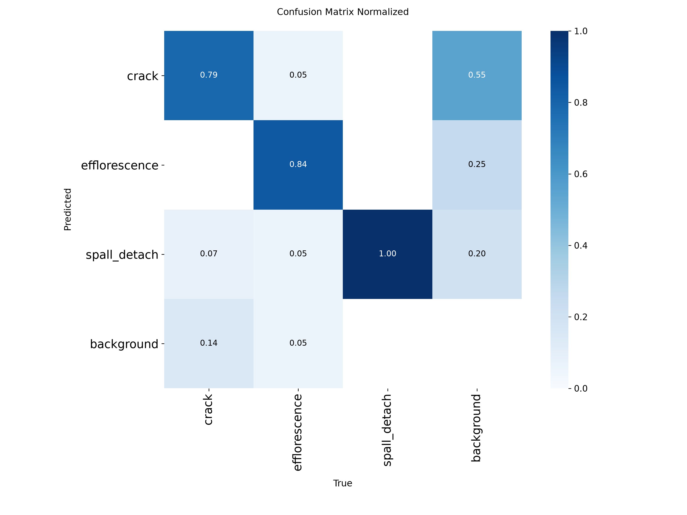
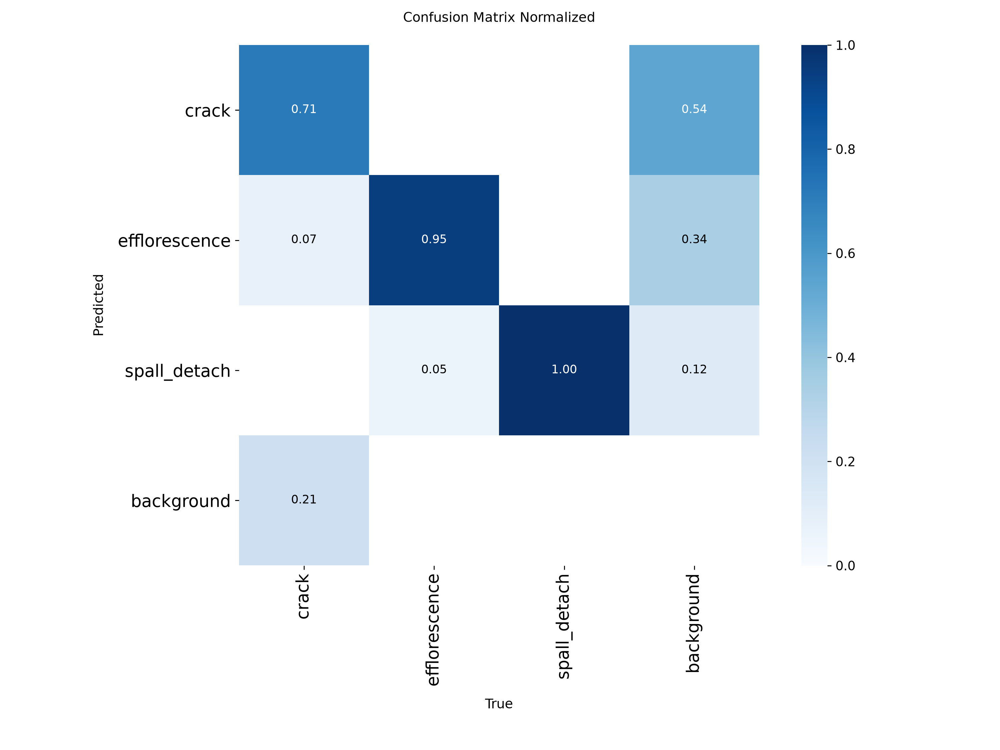
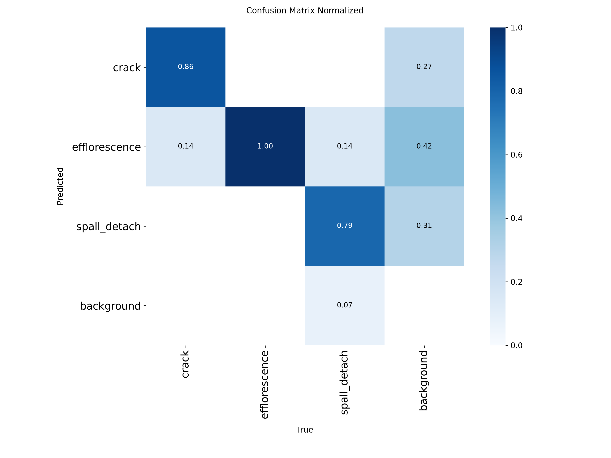

# <center>지하 구조물 결함 탐지 프로젝트 재현</center>

## 1. 코드 설명

본 프로젝트는 지하 구조물 표면 영상에서 균열(`crack`), 백태(`efflorescence`), 박리·박락(`spall_detach`) 영역을 탐지하고 분할하는 것을 목표로 한다. 사전 학습된 YOLOv8n-Seg, YOLOv8s-Seg, YOLOv8m-Seg를 동일한 3개 결함 클래스의 polygon annotation으로 미세 조정하고, 객체 단위 segmentation 성능과 이미지 단위 결함 존재 여부를 함께 비교하였다.

### 사용 데이터 및 전처리

- 데이터 형식: JPG 이미지와 YOLO segmentation 형식의 TXT polygon label
- 클래스: `crack`(0), `efflorescence`(1), `spall_detach`(2)
- 현재 데이터 구성: train 4,036장, validation 40장, test 40장
- 클래스가 포함된 이미지 수

|Split|crack|efflorescence|spall_detach|
|---|---:|---:|---:|
|Train|752|885|2,399|
|Validation|10|17|13|
|Test|13|13|14|

`src/visualization.py`는 증강 이미지 이름의 `_aug` 앞부분을 원본 ID로 간주하여 같은 원본에서 파생된 이미지가 서로 다른 split에 섞이지 않도록 그룹 단위로 분할한다. 분할 비율은 8:1:1, 난수 시드는 42이다. 라벨의 클래스 ID와 정규화 좌표 범위는 `src/format_check.py`와 `src/integrity_check.py`로 확인할 수 있다.


### 사용 모델 및 학습 방법

세 모델은 COCO 사전 학습 가중치와 동일한 학습 조건을 사용하였다.

|Model|Parameters|GFLOPs|Run|완료 epoch|Best epoch|
|---|---:|---:|---|---:|---:|
|YOLOv8n-Seg|3.39M|11.9|`runs/step3n`|53|33|
|YOLOv8s-Seg|11.78M|39.9|`runs/step3`|33|13|
|YOLOv8m-Seg|27.22M|104.3|`runs/step3m`|29|9|

- 입력 크기: 960 × 960
- 최대 epoch: 60
- batch size: 4
- optimizer: AdamW
- 초기 learning rate: 0.00015
- early stopping patience: 20
- seed: 42
- Mosaic 및 MixUp: 비활성화
- 체크포인트 선택 기준: Ultralytics segmentation fitness인 Box mAP50-95와 Mask mAP50-95의 합

각 모델은 validation fitness가 가장 높은 epoch의 가중치를 `best.pt`로 저장하였다. 이후 20 epoch 동안 개선되지 않으면 학습을 조기 종료했으며, test 데이터는 체크포인트 선택에 사용하지 않았다.



세 모델 모두 초반에 Mask mAP가 빠르게 상승한 뒤 epoch별 변동이 크게 나타났다. 특히 validation 데이터가 40장으로 작기 때문에 일부 이미지의 예측 변화가 전체 지표에 크게 반영된 것으로 보인다.

### 실행 방법

프로젝트 루트에서 다음 순서로 실행한다.

```powershell
# 가상환경 활성화
.\.venv\Scripts\Activate.ps1

# 데이터 및 라벨 점검
python src/format_check.py
python src/integrity_check.py

# 모델 학습과 학습 곡선 확인
python src/model_training.py
python src/training_check.py

# test split의 segmentation mAP 평가
python src/mAP50_check.py

# validation에서 임계값 선택 후 이미지 단위 ON/OFF 평가
python src/onoff_evaluation.py

# 대표 FP/FN 사례 저장
python src/error_analysis.py
```

현재 코드 실행에는 `ultralytics`, `opencv-python`, `PyYAML`, `torch`, `numpy`, `pandas`, `matplotlib`이 필요하다. 이 중 일부 패키지는 현재 `requirements.txt`에 명시되어 있지 않으므로 새 환경에서 재현할 때 별도 확인이 필요하다.

### 코드 설명

|파일|설명|
|---|---|
|`src/visualization.py`|원본 ID 기준 train/validation/test 분할 및 `data.yaml` 생성|
|`src/format_check.py`|YOLO detection/segmentation 라벨 형식 확인|
|`src/integrity_check.py`|클래스 ID와 정규화 좌표 범위의 이상 여부 확인|
|`src/model_training.py`|사전 학습 YOLOv8n/s/m-Seg 미세 조정|
|`src/training_check.py`|학습·검증 segmentation loss와 Mask mAP 곡선 생성|
|`src/mAP50_check.py`|`best.pt`의 test Box/Mask mAP 평가|
|`src/onoff_evaluation.py`|validation에서 클래스별 confidence threshold 선택 후 test 이미지 단위 P/R/F1 평가|
|`src/error_analysis.py`|test 예측의 클래스별 대표 FP/FN 시각화 저장|
|`src/legacy/data_check.py`|데이터 샘플과 영상 밝기 통계를 확인하는 초기 탐색 코드|
|`src/legacy/model_check.py`|PyTorch/CUDA 및 사전 학습 모델 로딩을 확인하는 초기 점검 코드|

## 2. 모델 성능 비교

각 모델에서 validation fitness로 선택한 `best.pt`를 동일한 test split 40장에 평가하였다.

### 이미지 단위 결함 존재 여부 성능

각 모델에 대해 validation split에서 클래스별 F1이 최대가 되는 confidence threshold를 선택한 뒤, 해당 threshold를 그대로 test split에 적용하였다. 표의 값은 세 클래스 one-vs-rest 성능의 macro 평균이며, Accuracy는 픽셀 정확도가 아니라 이미지에 해당 결함이 존재하는지에 대한 정확도이다.

|Model|Accuracy|Precision|Recall|F1-score|
|---|---:|---:|---:|---:|
|YOLOv8n-Seg — `best.pt`|0.900|0.835|0.923|0.865|
|YOLOv8s-Seg — `best.pt`|**0.933**|0.867|**0.951**|**0.906**|
|YOLOv8m-Seg — `best.pt`|**0.933**|**0.976**|0.822|0.889|

선택된 클래스별 confidence threshold는 다음과 같다.

|Model|crack|efflorescence|spall_detach|
|---|---:|---:|---:|
|YOLOv8n-Seg — `best.pt`|0.300|0.011|0.026|
|YOLOv8s-Seg — `best.pt`|0.128|0.017|0.026|
|YOLOv8m-Seg — `best.pt`|0.253|0.325|0.131|

#### 모델별 validation threshold 탐색






### 객체 분할 성능

동일한 test split 40장(총 47개 객체)에 대해 입력 크기 960, batch size 4로 재평가하였다. F1은 전체 mask precision과 recall의 조화 평균이다.

|Model|Mask Precision|Mask Recall|Mask F1|Mask mAP50|Mask mAP50-95|
|---|---:|---:|---:|---:|---:|
|YOLOv8n-Seg — `best.pt`|**0.679**|**0.699**|**0.689**|**0.705**|**0.329**|
|YOLOv8s-Seg — `best.pt`|0.597|0.648|0.621|0.652|0.309|
|YOLOv8m-Seg — `best.pt`|0.673|0.659|0.666|0.700|0.321|

클래스별 mask 성능은 다음과 같다.

|Model|Class|Precision|Recall|F1|mAP50|mAP50-95|
|---|---|---:|---:|---:|---:|---:|
|YOLOv8n-Seg|crack|0.531|0.567|0.548|0.495|0.161|
|YOLOv8n-Seg|efflorescence|0.650|0.684|0.667|0.701|0.373|
|YOLOv8n-Seg|spall_detach|0.855|0.846|0.851|0.920|0.453|
|YOLOv8s-Seg|crack|0.391|0.643|0.486|0.447|0.162|
|YOLOv8s-Seg|efflorescence|0.662|0.515|0.579|0.616|0.306|
|YOLOv8s-Seg|spall_detach|0.739|0.786|0.761|0.894|0.458|
|YOLOv8m-Seg|crack|0.729|0.578|0.645|0.633|0.203|
|YOLOv8m-Seg|efflorescence|0.645|0.684|0.664|0.679|0.297|
|YOLOv8m-Seg|spall_detach|0.643|0.714|0.677|0.788|0.463|

### 성능 분석

객체 분할에서는 YOLOv8n-Seg가 Mask F1 0.689, Mask mAP50 0.705, Mask mAP50-95 0.329로 가장 우수했다. 가장 작은 모델이 가장 좋은 분할 성능을 보였으므로, 현재 데이터 규모에서는 모델 크기 증가가 성능 향상으로 바로 이어지지 않았다.

이미지 단위 결함 존재 여부에서는 YOLOv8s-Seg가 macro F1 0.906과 recall 0.951로 가장 높았다. YOLOv8m-Seg는 precision 0.976으로 오탐지를 가장 잘 억제했지만 recall이 0.822로 낮아 실제 결함을 더 많이 놓쳤다. 따라서 결함 영역의 정확한 분할에는 Nano, 이미지 단위 결함 선별에는 Small, 오탐지 억제를 우선할 때는 Medium이 적합하다.

클래스별로는 세 모델 모두 `spall_detach`의 성능이 상대적으로 높았다. `crack`은 얇고 불규칙하며 배경 이음부와 유사해 전반적으로 가장 어려운 클래스였지만, YOLOv8m-Seg가 crack mask F1 0.645로 세 모델 중 가장 높은 값을 기록했다.

## 3. Confusion Matrix 분석

아래 행렬은 test split의 객체 단위 Confusion Matrix이다. 가로축은 실제 클래스(True), 세로축은 예측 클래스(Predicted)이며, `background` 행은 미탐지(FN), `background` 열은 배경을 결함으로 탐지한 오탐지(FP)를 뜻한다. 정규화 값은 각 실제 클래스 열을 기준으로 해석하였다.

### YOLOv8n-Seg — `best.pt`



- 가장 잘 분류된 클래스: `spall_detach` — 실제 객체 14개를 모두 정분류하여 정분류율 1.00
- 가장 많이 오분류된 클래스: `crack` — 14개 중 11개 정분류, 1개는 `spall_detach`로 분류되고 2개는 미탐지
- `efflorescence`: 19개 중 16개 정분류, 1개씩 `crack`·`spall_detach`로 분류되고 1개는 미탐지
- 배경 FP 구성: `crack` 55%, `efflorescence` 25%, `spall_detach` 20%

### YOLOv8s-Seg — `best.pt`



- 가장 잘 분류된 클래스: `spall_detach` — 실제 객체 14개를 모두 정분류하여 정분류율 1.00
- `efflorescence`: 19개 중 18개 정분류, 1개는 `spall_detach`로 분류
- 가장 많이 오분류된 클래스: `crack` — 14개 중 10개 정분류, 1개는 `efflorescence`로 분류되고 3개는 미탐지
- 배경 FP 구성: `crack` 54%, `efflorescence` 34%, `spall_detach` 12%

### YOLOv8m-Seg — `best.pt`



- 가장 잘 분류된 클래스: `efflorescence` — 실제 객체 19개를 모두 정분류하여 정분류율 1.00
- `crack`: 14개 중 12개 정분류, 2개는 `efflorescence`로 분류되었으나 미탐지는 없음
- 가장 많이 오분류된 클래스: `spall_detach` — 14개 중 11개 정분류, 2개는 `efflorescence`로 분류되고 1개는 미탐지
- 배경 FP 구성: `efflorescence` 42%, `spall_detach` 31%, `crack` 27%

Nano와 Small은 `spall_detach`를 안정적으로 분류했으며, Medium은 `crack`과 `efflorescence`의 미탐지를 줄이는 대신 `spall_detach` 일부를 `efflorescence`로 혼동했다. 세 모델 모두 background 열의 FP가 존재하므로, 배경만 포함한 hard negative 이미지 추가와 클래스별 confidence threshold 보정이 필요하다.

## 4. 최종 결과

- 객체 분할 성능이 가장 좋은 모델: YOLOv8n-Seg — Mask F1 0.689, Mask mAP50 0.705, Mask mAP50-95 0.329
- 이미지 단위 결함 판정이 가장 좋은 모델: YOLOv8s-Seg — Accuracy 0.933, Recall 0.951, macro F1 0.906
- precision이 가장 높은 모델: YOLOv8m-Seg — 이미지 단위 Precision 0.976
- 객체 분할 성능이 가장 낮은 모델: YOLOv8s-Seg — Mask F1 0.621, Mask mAP50 0.652
- 이미지 단위 성능이 가장 낮은 모델: YOLOv8n-Seg — Accuracy 0.900, macro F1 0.865
- 주요 오분류 클래스: `crack` — Nano와 Small에서 정분류율 및 mask F1이 가장 낮음
- 전체 결과: 영역 분할이 핵심인 본 프로젝트에서는 성능과 연산량을 함께 고려할 때 YOLOv8n-Seg가 가장 효율적이다. 다만 이미지 전체의 결함 존재 여부를 높은 recall로 선별하는 목적에는 YOLOv8s-Seg가 더 적합하다. validation/test가 각각 40장으로 작고 train 클래스 분포가 불균형하므로, 독립 데이터 확대와 반복 실험을 통해 순위를 재확인할 필요가 있다.

## 5. 재현 환경 및 평가 기록

- 평가 환경: Python 3.13.8, PyTorch 2.14.1+cu132, Ultralytics 8.4.198
- GPU: NVIDIA GeForce RTX 4070 12 GB
- 평가 데이터: test 이미지 40장, 객체 47개
- 입력 크기 / batch size: 960 / 4
|Model|Best epoch|평균 추론 시간|평가 결과|
|---|---:|---:|---|
|YOLOv8n-Seg|33|6.1 ms/image|`runs/segment/report_compare/v8n`|
|YOLOv8s-Seg|13|5.5 ms/image|`runs/segment/report_compare/v8s`|
|YOLOv8m-Seg|9|11.8 ms/image|`runs/segment/report_compare/v8m`|

추론 시간은 동일 GPU에서 test 이미지 40장을 한 번 평가한 측정값이므로, 정밀한 속도 비교에는 반복 측정과 warm-up이 추가로 필요하다.
