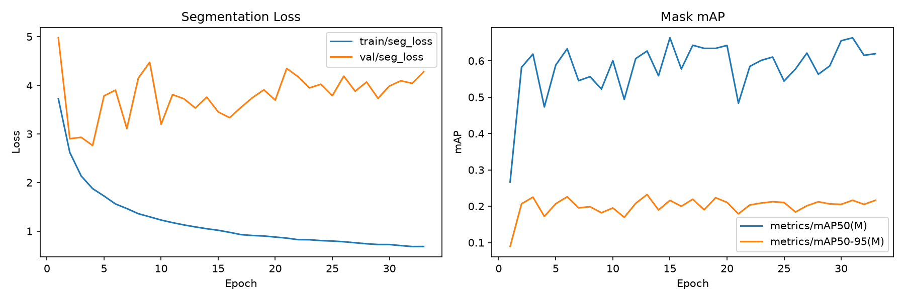
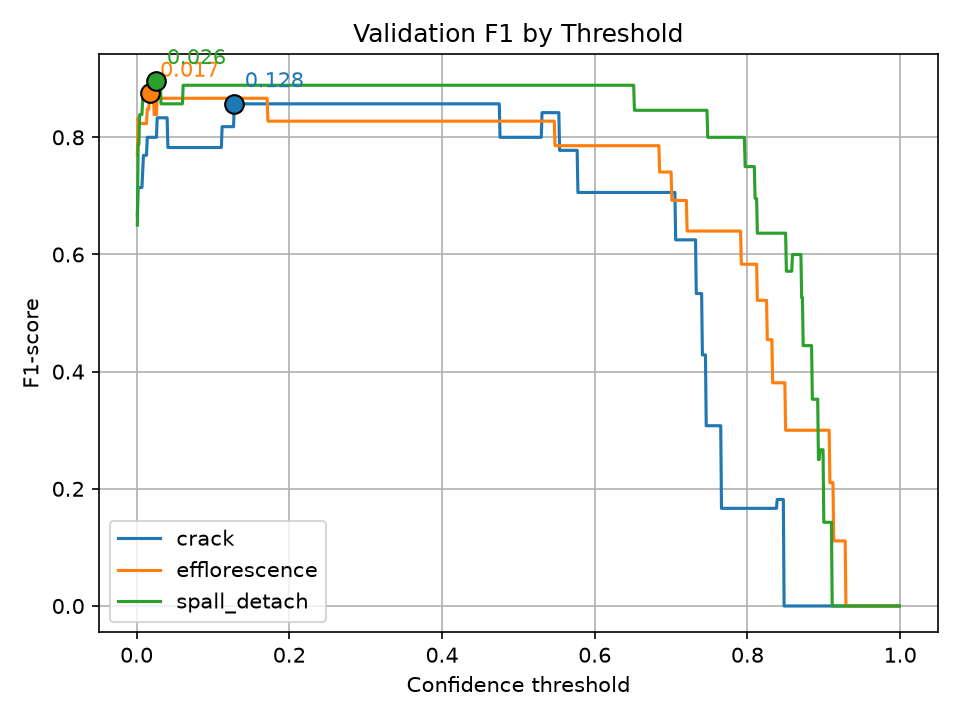
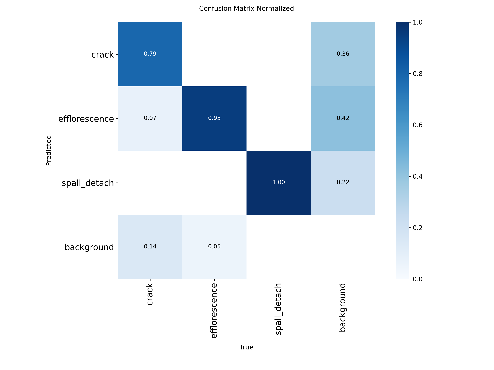

# <center>지하 구조물 결함 탐지 프로젝트 재현</center>

## 1. 코드 설명

본 프로젝트는 지하 구조물 표면 영상에서 균열(`crack`), 백태(`efflorescence`), 박리·박락(`spall_detach`) 영역을 탐지하고 분할하는 것을 목표로 한다. 사전 학습된 YOLOv8s-Seg를 3개 결함 클래스의 polygon annotation으로 미세 조정하고, 객체 단위 segmentation 성능과 이미지 단위 결함 존재 여부를 함께 평가하였다.

### 사용 데이터 및 전처리

- 데이터 형식: JPG 이미지와 YOLO segmentation 형식의 TXT polygon label
- 클래스: `crack`(0), `efflorescence`(1), `spall_detach`(2)
- 현재 데이터 구성: train 4,036장, validation 40장, test 40장
- 클래스가 포함된 이미지 수

|Split|crack|efflorescence|spall_detach|
|---|---:|---:|---:|
|Train|752|885|2,399|
|Validation|10|17|13|
|Test|13|13|14|

`src/visualization.py`는 증강 이미지 이름의 `_aug` 앞부분을 원본 ID로 간주하여 같은 원본에서 파생된 이미지가 서로 다른 split에 섞이지 않도록 그룹 단위로 분할한다. 분할 비율은 8:1:1, 난수 시드는 42이다. 라벨의 클래스 ID와 정규화 좌표 범위는 `src/format_check.py`와 `src/integrity_check.py`로 확인할 수 있다.


### 사용 모델 및 학습 방법

- 모델: COCO 사전 학습 YOLOv8s-Seg(small)
- 모델 규모: 11,780,761 parameters, 39.9 GFLOPs
- 입력 크기: 960 × 960
- 최대 epoch: 60, 실제 종료: 33 epoch
- batch size: 4
- optimizer: AdamW
- 초기 learning rate: 0.00015
- early stopping patience: 20
- seed: 42
- Mosaic 및 MixUp: 비활성화
- 체크포인트 선택 기준: Ultralytics segmentation fitness인 Box mAP50-95와 Mask mAP50-95의 합

validation fitness가 가장 높았던 epoch 13의 가중치가 `best.pt`로 저장되었고, 이후 20 epoch 동안 성능이 개선되지 않아 epoch 33에서 조기 종료된 가중치가 `last.pt`로 저장되었다. 두 체크포인트의 test 성능을 같은 조건에서 비교하였다.



학습 loss는 지속적으로 감소했지만 validation segmentation loss는 초반 이후 다시 증가하였다. 반면 validation Mask mAP는 큰 폭으로 진동하여, validation 데이터 40장만으로 최적 체크포인트를 안정적으로 선택하기 어렵고 일부 과적합 가능성이 있음을 보여준다.

### 실행 방법

프로젝트 루트에서 다음 순서로 실행한다.

```powershell
# 가상환경 활성화
.\.venv\Scripts\Activate.ps1

# 데이터 및 라벨 점검
python src/format_check.py
python src/integrity_check.py

# 모델 학습과 학습 곡선 확인
python src/model_training.py
python src/training_check.py

# test split의 segmentation mAP 평가
python src/mAP50_check.py

# validation에서 임계값 선택 후 이미지 단위 ON/OFF 평가
python src/onoff_evaluation.py

# 대표 FP/FN 사례 저장
python src/error_analysis.py
```

현재 코드 실행에는 `ultralytics`, `opencv-python`, `PyYAML`, `torch`, `numpy`, `pandas`, `matplotlib`이 필요하다. 이 중 일부 패키지는 현재 `requirements.txt`에 명시되어 있지 않으므로 새 환경에서 재현할 때 별도 확인이 필요하다.

### 코드 설명

|파일|설명|
|---|---|
|`src/visualization.py`|원본 ID 기준 train/validation/test 분할 및 `data.yaml` 생성|
|`src/format_check.py`|YOLO detection/segmentation 라벨 형식 확인|
|`src/integrity_check.py`|클래스 ID와 정규화 좌표 범위의 이상 여부 확인|
|`src/model_training.py`|사전 학습 YOLOv8s-Seg 미세 조정|
|`src/training_check.py`|학습·검증 segmentation loss와 Mask mAP 곡선 생성|
|`src/mAP50_check.py`|`best.pt`의 test Box/Mask mAP 평가|
|`src/onoff_evaluation.py`|validation에서 클래스별 confidence threshold 선택 후 test 이미지 단위 P/R/F1 평가|
|`src/error_analysis.py`|test 예측의 클래스별 대표 FP/FN 시각화 저장|
|`src/legacy/data_check.py`|데이터 샘플과 영상 밝기 통계를 확인하는 초기 탐색 코드|
|`src/legacy/model_check.py`|PyTorch/CUDA 및 사전 학습 모델 로딩을 확인하는 초기 점검 코드|

## 2. 모델 성능 비교

두 모델은 아키텍처와 학습 설정은 같지만 저장 시점이 다른 체크포인트이다.

- Model 1: `best.pt` — validation fitness가 가장 높았던 epoch 13
- Model 2: `last.pt` — early stopping으로 학습이 종료된 epoch 33

### 이미지 단위 결함 존재 여부 성능

각 모델에 대해 validation split에서 클래스별 F1이 최대가 되는 confidence threshold를 선택한 뒤, 해당 threshold를 그대로 test split에 적용하였다. 표의 값은 세 클래스 one-vs-rest 성능의 macro 평균이며, Accuracy는 픽셀 정확도가 아니라 이미지에 해당 결함이 존재하는지에 대한 정확도이다.

|Model|Accuracy|Precision|Recall|F1-score|
|---|---:|---:|---:|---:|
|Model 1 — `best.pt`|0.933|0.867|**0.951**|0.906|
|Model 2 — `last.pt`|**0.958**|**0.949**|0.923|**0.935**|

선택된 클래스별 confidence threshold는 다음과 같다.

|Model|crack|efflorescence|spall_detach|
|---|---:|---:|---:|
|Model 1 — `best.pt`|0.128|0.017|0.026|
|Model 2 — `last.pt`|0.142|0.047|0.320|



### 객체 분할 성능

동일한 test split 40장(총 47개 객체)에 대해 입력 크기 960, batch size 4로 재평가하였다. F1은 전체 mask precision과 recall의 조화 평균이다.

|Model|Mask Precision|Mask Recall|Mask F1|Mask mAP50|Mask mAP50-95|
|---|---:|---:|---:|---:|---:|
|Model 1 — `best.pt`|0.597|0.648|0.621|0.652|0.309|
|Model 2 — `last.pt`|**0.807**|**0.663**|**0.728**|**0.737**|**0.342**|

클래스별 mask 성능은 다음과 같다.

|Model|Class|Precision|Recall|F1|mAP50|
|---|---|---:|---:|---:|---:|
|Model 1|crack|0.391|0.643|0.486|0.447|
|Model 1|efflorescence|0.662|0.515|0.579|0.616|
|Model 1|spall_detach|0.739|0.786|0.761|0.894|
|Model 2|crack|0.885|0.554|0.681|0.672|
|Model 2|efflorescence|0.621|0.579|0.599|0.633|
|Model 2|spall_detach|0.916|0.857|0.886|0.906|

### 성능 분석

test split에서는 Model 2(`last.pt`)가 이미지 단위 macro F1 0.935와 Mask mAP50 0.737로 가장 우수했다. Model 1보다 recall은 소폭 낮지만 precision이 크게 높아져 전체 F1이 향상되었으며, 객체 분할에서도 모든 종합 지표가 높았다. 특히 `spall_detach`는 Model 2에서 이미지 단위 Accuracy, Precision, Recall, F1이 모두 1.0이었고 mask F1도 0.886으로 가장 안정적이었다.

`best.pt`가 validation 기준 최적임에도 test에서 `last.pt`보다 낮은 결과를 보인 이유는 체크포인트 선택 기준이 이미지 단위 F1이 아니라 Box/Mask mAP50-95 합이고, validation과 test가 각각 40장으로 작아 표본에 따른 변동이 크기 때문이다. 따라서 이 결과만으로 epoch 33이 항상 우수하다고 일반화하기보다 더 큰 validation/test set 또는 교차 검증으로 확인할 필요가 있다.

## 3. Confusion Matrix 분석

아래 행렬은 test split의 객체 단위 Confusion Matrix이다. 가로축은 실제 클래스(True), 세로축은 예측 클래스(Predicted)이며, `background` 행은 미탐지(FN), `background` 열은 배경을 결함으로 탐지한 오탐지(FP)를 뜻한다. 정규화 값은 각 실제 클래스 열을 기준으로 해석하였다.

### Model 1 — `best.pt`


- 가장 잘 분류된 클래스: `spall_detach` — 실제 객체 14개 중 14개가 올바르게 분류되어 정분류율 1.00
- 다음으로 잘 분류된 클래스: `efflorescence` — 19개 중 18개 정분류, 정분류율 0.95
- 가장 많이 오분류된 클래스: `crack` — 14개 중 10개 정분류, 1개는 `efflorescence`로 분류되고 3개는 미탐지
- 주요 오분류 유형: 배경 질감을 결함으로 검출한 FP가 많았으며, FP 구성은 `crack` 54%, `efflorescence` 34%, `spall_detach` 12% 순
- 원인 분석: 균열은 가늘고 명암 대비가 약해 구조물 이음부나 표면 무늬와 구분하기 어렵다. 또한 train에서 `crack` 포함 이미지가 752장으로 `spall_detach` 2,399장보다 적은 클래스 불균형도 영향을 주었을 가능성이 있다.

### Model 2 — `last.pt`



- 가장 잘 분류된 클래스: `spall_detach` — 실제 객체 14개를 모두 정분류하여 정분류율 1.00
- 다음으로 잘 분류된 클래스: `efflorescence` — 19개 중 18개 정분류, 1개 미탐지
- 가장 많이 오분류된 클래스: `crack` — 14개 중 11개 정분류, 1개는 `efflorescence`로 분류되고 2개는 미탐지
- 주요 오분류 유형: Model 1보다 `crack`의 미탐지가 3개에서 2개로 감소했지만, 배경 FP는 여전히 남았다. FP 구성은 `efflorescence` 42%, `crack` 36%, `spall_detach` 22% 순
- 원인 분석: 추가 학습으로 결함과 배경의 구분은 개선되었으나, 백태와 콘크리트의 밝은 얼룩이 시각적으로 유사하고 균열의 폭·대비가 다양하여 일부 오탐지와 미탐지가 지속된 것으로 보인다.

두 모델 모두 결함 클래스끼리의 혼동은 적고, 주요 오류는 결함과 background 사이에서 발생했다. 따라서 후속 개선에서는 배경만 포함한 hard negative 이미지 추가, `crack` 표본 확충, 클래스별 confidence threshold 보정이 효과적일 것으로 예상된다.

## 4. 최종 결과

- 가장 성능이 좋은 모델: Model 2(`last.pt`, epoch 33) — 이미지 단위 macro F1 0.935, Mask mAP50 0.737
- 가장 성능이 낮은 모델: Model 1(`best.pt`, epoch 13) — 이미지 단위 macro F1 0.906, Mask mAP50 0.652
- 주요 오분류 클래스: `crack` — 두 모델 모두 클래스별 mask F1이 가장 낮고 객체 미탐지가 가장 많음
- 가장 안정적인 클래스: `spall_detach` — 두 모델 모두 객체 Confusion Matrix 정분류율 1.00
- 전체 결과: YOLOv8s-Seg는 박리·박락에서 높은 성능을 보였고, 학습 종료 체크포인트가 test에서 validation 최적 체크포인트보다 우수했다. 다만 작은 validation/test 규모와 train 클래스 불균형 때문에 성능 추정의 분산이 클 수 있다. 실제 적용 전에는 독립 데이터 확대, hard negative 보강, 균열 데이터 증대, checkpoint 선택 기준과 운영 지표의 일치 여부를 추가로 검증해야 한다.

## 5. 재현 환경 및 평가 기록

- 평가 환경: Python 3.13.8, PyTorch 2.14.1+cu132, Ultralytics 8.4.198
- GPU: NVIDIA GeForce RTX 4070 12 GB
- 평가 데이터: test 이미지 40장, 객체 47개
- 입력 크기 / batch size: 960 / 4
- Model 1 평균 추론 시간: 이미지당 6.4 ms
- Model 2 평균 추론 시간: 이미지당 5.9 ms
- 생성된 평가 결과: `runs/segment/report_artifacts/best`, `runs/segment/report_artifacts/last`
